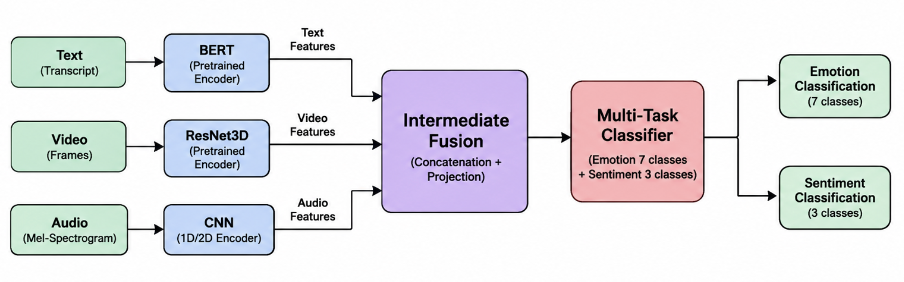

# Multimodal Emotion-Sentiment Detection

A trimodal (text + video + audio) emotion and sentiment classification system trained on the MELD benchmark. The project studies **class-imbalance mitigation**: how inverse-frequency class weighting changes the model's behavior on MELD's heavily neutral-skewed labels.

📄 Accompanying paper: *Class-Imbalance Mitigation in Trimodal Emotion and Sentiment Recognition on MELD* (IEEE format).

## Overview

MELD is dominated by neutral utterances: 47.2% of training samples are neutral, while fear and disgust each make up only 2.7%. A classifier trained with plain cross-entropy can score well on accuracy just by over-predicting "neutral." This project trains the same trimodal model twice, once unweighted and once with inverse-frequency class weights, and compares accuracy against weighted precision on both tasks.

- **Text:** BERT (`bert-base-uncased`), frozen backbone
- **Video:** ResNet3D-18, pretrained on Kinetics-400, frozen backbone
- **Audio:** Custom 1D CNN over mel-spectrograms, trained from scratch (no pretrained audio backbone used)
- **Fusion:** Intermediate fusion — modality embeddings concatenated after encoding, before classification
- **Tasks:** Joint multi-task prediction — 7-class emotion + 3-class sentiment, trained together via a combined cross-entropy loss

## Dataset

[MELD](https://affective-meld.github.io/) (Multimodal EmotionLines Dataset) — sourced from *Friends* TV show dialogues.

| Split | Utterances |
|---|---|
| Train | 9,989 |
| Validation | 1,109 |
| Test | 2,610 |

- **Emotion labels (7-class):** anger, disgust, fear, joy, neutral, sadness, surprise
- **Sentiment labels (3-class):** negative, neutral, positive
- Official MELD train/val/test splits are used as-is. No custom re-splitting was performed.
- Two raw samples are unusable (`dia125_utt3.mp4` in train is corrupt; `dia110_utt7.mp4` in dev is missing), so the effective sizes are 9,988 train and 1,108 dev.

### Label Imbalance

| Emotion | Train | Dev | Test | Train % |
|---|---|---|---|---|
| Neutral | 4,710 | 470 | 1,256 | 47.2 |
| Joy | 1,743 | 163 | 402 | 17.4 |
| Surprise | 1,205 | 150 | 281 | 12.1 |
| Anger | 1,109 | 153 | 345 | 11.1 |
| Sadness | 683 | 111 | 208 | 6.8 |
| Disgust | 271 | 22 | 68 | 2.7 |
| Fear | 268 | 40 | 50 | 2.7 |

| Sentiment | Train | Dev | Test | Train % |
|---|---|---|---|---|
| Neutral | 4,710 | 470 | 1,256 | 47.2 |
| Negative | 2,945 | 406 | 833 | 29.5 |
| Positive | 2,334 | 233 | 521 | 23.4 |

Emotion has a 17.6 : 1 majority-to-minority ratio; sentiment is much milder at 2.0 : 1.

Raw dataset (~10GB video + audio) is expected in the following structure:
```
MELD.Raw/
├── train/
│   ├── train_sent_emo.csv
│   └── train_splits/            (.mp4 files)
├── dev_sent_emo.csv
├── dev/
│   └── dev_splits_complete/     (.mp4 files)
├── test_sent_emo.csv
└── test/
    └── output_repeated_splits_test/  (.mp4 files)
```

## Architecture


### Text Encoder
- `bert-base-uncased`, weights frozen (`requires_grad = False`)
- Input tokenized to fixed length 128 (padding + truncation)
- `[CLS]` pooled output (768-dim) → linear projection → 128-dim embedding

### Video Encoder
- `r3d_18`, pretrained on Kinetics-400, weights frozen
- 30 frames sampled per clip (padded with black frames if the clip is shorter), resized to 224×224, normalized
- Custom head: `Linear(512→128) → ReLU → Dropout(0.2)`

### Audio Encoder
- Randomly initialized 1D CNN (not pretrained — no strong pretrained audio backbone used)
- Input: mel-spectrogram, 64 mel bins, padded/truncated to 300 time steps
- Two conv blocks (64→128 channels) + adaptive pooling → projection head to 128-dim

### Fusion & Classification
- Three 128-dim embeddings concatenated → 384-dim vector
- Fusion layer: `Linear(384→256) → BatchNorm → ReLU → Dropout(0.3)`
- Two independent classifier heads on top of the shared 256-dim fused representation:
  - Emotion: `Linear(256→64) → ReLU → Dropout(0.2) → Linear(64→7)`
  - Sentiment: `Linear(256→64) → ReLU → Dropout(0.2) → Linear(64→3)`

**Why intermediate fusion:** preserves each modality's specialized representation while still letting the model learn cross-modal interactions before the final decision — unlike early fusion (raw input concatenation) or late fusion (combining independent per-modality predictions).

**Why frozen backbones:** standard transfer learning approach given the limited size of MELD relative to what BERT/ResNet3D were originally pretrained on; also keeps training feasible within free-tier GPU compute limits.

## Data Preprocessing

- **Text:** BERT WordPiece tokenization, fixed length 128, attention mask generated for padding.
- **Video:** Frames extracted via OpenCV, resized to 224×224, normalized to [0,1], padded/truncated to exactly 30 frames per clip.
- **Audio:** Extracted from the video file via `ffmpeg` (mono, 16kHz, PCM), converted to a mel-spectrogram via `torchaudio`, normalized, padded/truncated to 300 time steps.
- **Corrupt file handling:** `MELDDataset.__getitem__` wraps all processing in a try/except; failed samples (corrupt video, missing file) are logged and return `None`, filtered out by a custom `collate_fn` before batching — so a small number of known-corrupt files in the raw MELD release don't crash training.

## Training Setup

| Component | Value |
|---|---|
| Hardware | NVIDIA Tesla T4, 16 GB (Kaggle) |
| Optimizer | Adam, weight decay 1e-5 |
| Encoder LR (text, video, audio) | 8e-5 |
| Fusion / classifier LR | 5e-4 |
| LR scheduler | `ReduceLROnPlateau` (factor 0.1, patience 2) |
| Loss | Cross-entropy (emotion + sentiment), label smoothing 0.05; class weights for the weighted model only |
| Gradient clipping | max norm 1.0 |
| Batch size | 16 (last partial batch dropped) |
| Epochs | 20 |
| Time per epoch | ≈60 min |
| Peak GPU memory | 8.0 GB |

**Differential learning rates:** pretrained encoders use small LRs to avoid overwriting useful pretrained knowledge (catastrophic forgetting); fusion/classifier layers use a larger LR since they start from random initialization and need bigger updates to learn.

**Multi-task loss:** `total_loss = emotion_loss + sentiment_loss`, backpropagated jointly in a single pass — shared encoder/fusion layers receive gradient signal from both tasks simultaneously.

**Checkpointing:** a full checkpoint (weights, optimizer/scheduler state, epoch, best val loss) is saved every epoch so training can resume after a Kaggle session interruption.

## Class-Imbalance Mitigation

The weighted model gives each class a weight inversely proportional to its training frequency, normalized to sum to 1 per task (`compute_class_weights` in `training/models.py`). The loss is normalized by the batch's total target weight, so only the ratios between weights matter.

| Task | Class | Train count | Weight |
|---|---|---|---|
| Emotion | Neutral | 4,710 | 0.0186 |
| Emotion | Joy | 1,743 | 0.0503 |
| Emotion | Surprise | 1,205 | 0.0728 |
| Emotion | Anger | 1,109 | 0.0791 |
| Emotion | Sadness | 683 | 0.1284 |
| Emotion | Disgust | 271 | 0.3236 |
| Emotion | Fear | 268 | 0.3272 |
| Sentiment | Neutral | 4,710 | 0.2166 |
| Sentiment | Negative | 2,945 | 0.3464 |
| Sentiment | Positive | 2,334 | 0.4370 |

A fear sample contributes about 17.6× more to the gradient than a neutral one.

## Results

Two configurations share the same architecture, splits, preprocessing, label smoothing and 20-epoch schedule. The only difference is class weighting. Both are evaluated on the MELD test set using the final-epoch model.

| Model | Emotion Acc | Emotion W-Prec | Sentiment Acc | Sentiment W-Prec |
|---|---|---|---|---|
| Baseline (unweighted) | 61.92 | 57.98 | 66.93 | 66.55 |
| Class-weighted | 48.35 | **62.04** | 65.79 | **67.23** |
| **Change (points)** | −13.57 | +4.06 | −1.14 | +0.68 |

*All values in %. W-Prec = weighted precision, the primary metric.*

**Key findings**

- **Emotion:** weighting raises weighted precision by 4.06 points but lowers accuracy by 13.57. The weighted model predicts neutral less often. Neutral is 48.1% of the test set, so each neutral utterance it misses costs accuracy, while fewer minority-class utterances get absorbed into neutral.
- **Sentiment:** both metrics move by about one point. The trade-off is much smaller where the imbalance is milder (2.0 : 1 vs 17.6 : 1).
- **Accuracy is misleading here:** the weighted model's 48.35% emotion accuracy is barely above an always-neutral classifier (48.1%), despite its higher weighted precision.


## Future Work

- Compare inverse-frequency weighting with class-balanced loss and focal loss
- Report per-class and macro-averaged F1
- Add dialogue context via a recurrent or graph layer over utterance embeddings
- Replace the scratch audio CNN with a pretrained speech encoder

